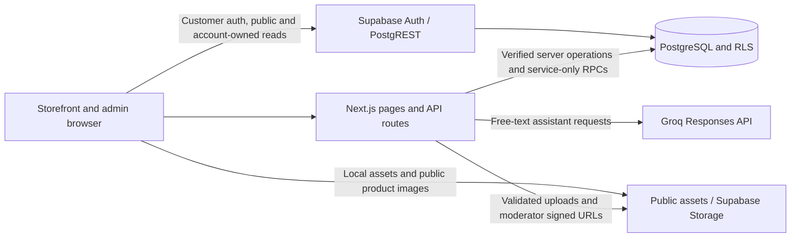

# zeouf — Architecture Overview

Updated 24 October 2026 against the current working copy. This document describes the checked-in design and current assistant changes. [docs/BRD.md](docs/BRD.md) owns requirement IDs and known gaps; [docs/QA_TESTING_GUIDE.md](docs/QA_TESTING_GUIDE.md) records fixtures and dated execution evidence. Source inspection does not establish live integration acceptance.

zeouf is a portfolio demonstration. Checkout can save demo orders and decrement inventory, but no money is charged, delivery arranged, or returns/support follow-up provided.

## System boundaries

The application uses Next.js 16 App Router, React 19, TypeScript, Tailwind CSS 4 and scoped assistant CSS. Supabase supplies customer authentication, Postgres/PostgREST and Storage. Groq supplies free-text assistant tool selection through the `openai` SDK; the assistant has no OpenAI credential/service fallback.



| Boundary | Responsibility and authority | Main source |
|---|---|---|
| Shared UI | Root providers wrap storefront/admin routes. SiteShell adds navbar, one main landmark, footer and assistant only outside admin. | [layout](src/app/layout.tsx), [SiteShell](src/components/SiteShell.tsx) |
| Public catalog | Public RLS reads use the anon client. Unconfigured Supabase permits bundled fallback browsing; it does not supply working authentication or commerce. | [Supabase adapter](src/lib/supabase.ts), [catalog deadline](src/lib/catalogRequest.ts) |
| Customer identity | Supabase bearer tokens are verified server-side before protected customer operations. Client-supplied user IDs are not authoritative. | [checkout](src/app/api/checkout/route.ts), [assistant handler](src/lib/assistant/handler.ts) |
| Admin identity | Named password hashes and a signed HttpOnly cookie protect server routes independently of browser UI flags. | [admin auth](src/lib/adminAuth.ts), [admin login](src/app/api/admin/login/route.ts) |
| Privileged persistence | Service-role clients stay in server handlers. Sensitive mutations use validated APIs and protected database functions where implemented. Applied grants/RLS still require staging verification. | [admin catalog](src/lib/adminCatalog.ts), [purchase safeguards](supabase_purchase_safeguards_migration.sql) |
| External services | Groq handles assistant model requests; the region route reads an exchange rate; optional mail supports restock batches. No payment or shipping integration exists. | [assistant](src/lib/assistant/handler.ts), [region](src/app/api/storefront/region/route.ts), [route inventory](docs/BRD.md#9-integrations-and-api-inventory) |

Public URLs use English category names. Legacy App Router directory names are mapped by [next.config.ts](next.config.ts); the detailed route inventory remains in the BRD.

## Browser state and catalog reads

- [CartContext](src/context/CartContext.tsx) and [cartStorage](src/lib/cartStorage.ts) restore validated `els-cart` lines and provide recovery feedback. Adding requires a customer session. The bag remains browser-wide across account changes; the `cart_items` table is not used for storefront persistence (G-10).
- [FavoritesContext](src/context/FavoritesContext.tsx) uses account-owned Supabase favorites. [AuthPromptContext](src/context/AuthPromptContext.tsx) opens the login prompt for gated actions.
- [CurrencyContext](src/context/CurrencyContext.tsx) uses `/api/storefront/region` for INR/USD display context. US display uses an INR-to-USD rate; failures fall back to INR. Display amounts round to whole units; catalog, proposal and order values remain INR.
- Checkout retains an attempt UUID and payload digest in same-tab sessionStorage for retry/reload recovery. The stored digest does not contain raw contact fields; the shopper must re-enter the same details after reload.
- Assistant conversations, ordered product references, comparison selections, proposals and confirmation flags live only in widget memory. Reset/account changes clear them; closing and reopening the panel preserves the conversation.
- Product detail server lookup and its known navigation limits are described in [the product-navigation investigation](docs/PRODUCT_NAVIGATION_INVESTIGATION.md). The assistant's request deadlines do not add a deadline or loading boundary to those product routes.

## Shopping assistant

### UI and lifecycle

[ShoppingAssistant.tsx](src/components/ShoppingAssistant.tsx), [AssistantProductCard.tsx](src/components/AssistantProductCard.tsx) and [shopping-assistant.css](src/components/shopping-assistant.css) implement the non-modal Ask Zeouf panel.

The UI includes editorial welcome/suggestion cards, product comparison, similar-product discovery, size/color/quantity choices, explicit bag confirmation and View bag. Scoped CSS animates panel/message/loading/selection/confirmation feedback. Reduced-motion preference disables animations/transitions and smooth scrolling. Closing immediately makes the panel inert and hidden to assistive technology, then removes it after 180 ms; rapid reopening cancels removal.

The composer grows to 128px before scrolling. VisualViewport events fit the panel around mobile keyboard space. Readers can scroll older replies without being pulled to the bottom; Latest message or sending resumes following. These behaviors have scoped Chromium fixtures; native phone keyboards, screen readers and rendering performance remain separate checks.

### Request and tool flow

```mermaid
sequenceDiagram
    participant UI as Assistant widget
    participant API as POST /api/assistant
    participant Model as Groq (free text only)
    participant Tools as Validated server tools
    participant Catalog as Catalog / checked-in policies
    UI->>API: Bounded messages, references, display context, optional interaction
    API->>API: Shared limiter, payload checks, optional bearer verification
    alt Free-text chat
        API->>Catalog: Freshly rehydrate latest ordered product references
        API->>Model: History, reference facts, instructions and tool definitions
        Model-->>API: Tool calls / card ID markers
        API->>Tools: Validate and execute tool arguments
        Tools->>Catalog: Read relevant facts
        Catalog-->>Tools: Catalog facts or policy summaries
        Tools-->>API: Tool output and factual reply sections
        Note over API,Model: Tool exchange may repeat within one overall deadline
    else Compare / similar / prepare_add
        API->>Tools: Validated interaction; no model/key needed
        Tools->>Catalog: Read catalog facts
        Tools-->>API: Cards, factual sections and optional proposal
    end
    API-->>UI: Tool-composed reply, up to 3 catalog cards, optional proposal
```

| Module | Responsibility |
|---|---|
| [handler.ts](src/lib/assistant/handler.ts) | Validates bounded history, ordered reference IDs, display context and interaction payloads; verifies bearer tokens; applies the shared chat limiter. |
| [chat.ts](src/lib/assistant/chat.ts) | Free-text Responses loop and deterministic card interactions. Uses server-rendered factual copy; raw model prose is never displayed. Unknown card IDs are dropped and no-tool replies use a safe fallback. |
| [tools.ts](src/lib/assistant/tools.ts) | Validated search, details, availability, related products, categories, cart reads, bag proposals and checked-in policies. Search matches category boundaries/aliases and converts numeric budgets once. |
| [catalogStore.ts](src/lib/assistant/catalogStore.ts) | Public read-only catalog/size-stock adapter; ordinary recommendations use a 30-second process cache. Reference follow-ups freshly reload facts and keep subsequent tools on that request snapshot. |
| [inventory.ts](src/lib/assistant/inventory.ts) | Configured variant membership, valid unique size-stock rows and shared stock across colors. Missing/duplicate/retired size rows never manufacture availability. Demo contact-sheet products suppress selectable colors. |
| [presentation.ts](src/lib/assistant/presentation.ts) | Validates INR/1 or finite positive USD display rates up to 1000, formats factual cart copy and keeps purchase values in INR. USD budget filters require an available USD rate. |
| [requestLifetime.ts](src/lib/assistant/requestLifetime.ts) | Overall request deadlines, cancellation-aware waits and propagation to supported provider/auth/catalog/limiter requests. |
| [confirm.ts](src/lib/assistant/confirm.ts) | Fresh, authenticated read-only validation before the client adds a proposal to its bag. |
| [prompt.ts](src/lib/assistant/prompt.ts), [policies.ts](src/lib/assistant/policies.ts) | Tool-routing rules and portfolio-demo policy facts. Catalog-authored text is untrusted data. |

Free-text requests use server-only `GROQ_API_KEY`, with default model `openai/gpt-oss-20b` or nonblank `GROQ_MODEL`. The loop is non-streaming, has no automatic SDK retries, and permits four tool rounds plus a final model request with 700 output tokens per call. Requests omit unsupported `store`. Recent messages and tool/reference context go to Groq; in-memory application state does not establish provider retention behavior.

History accepts 1–50 raw entries and validates/processes only the last 12, with at most 1,000 characters per entry and a final user message. Assistant entries can carry up to three unique ordered product IDs. Fresh reference data preserves original positions when a product is removed, so ordinal follow-ups do not silently shift items. Tool calls return at most eight products; UI replies contain at most three cards.

### Bag confirmation and deadlines

1. `addToCart` or the card's Review bag addition action proposes a product/variant/quantity without mutating the bag. Bag tools require a verified customer; browser-supplied cart snapshots are not a server-owned cart.
2. Confirm posts the bearer token, INR proposal price/options/quantity and current bag lines to `POST /api/assistant/confirm`.
3. The server bypasses the catalog cache, checks listed options, price and available stock including quantities already in the bag, then returns an authoritative action. It saves nothing and reserves no inventory.
4. The widget rechecks the account, conversation generation and unchanged bag, prevents duplicate confirms, and shows success only after CartContext accepts the addition for that account.
5. Checkout remains the authoritative transaction and revalidates inventory. Separate fresh product/stock reads are not an atomic snapshot (G-26).

| Scope | Deadline / limit |
|---|---|
| Complete server chat or card interaction | 35 seconds, including body/limiter/auth/tools/model rounds |
| Complete server confirmation | 10 seconds |
| Individual provider call | 25 seconds; no automatic retry |
| Browser chat / confirmation fallback waits | 45 / 15 seconds |
| Chat / confirmation address limits | Separate keys, each 10 requests per minute |
| Confirmation bag input / proposed quantity | Up to 30 valid lines / integer quantity 1–10 |

Deadline/cancellation returns a safe 504 when the connection remains available and prevents later model rounds. Actual deployment disconnect propagation remains a staging check.

## Inventory and demo checkout

Sized products use only configured `product_size_stock` rows; unsized products use `products.stock`. Colors share product/size inventory. Protected stock updates and catalog size edits use parent-product-first locking compatible with checkout.

[POST /api/checkout](src/app/api/checkout/route.ts) verifies the bearer session and normalizes a UUID attempt key, product/options/quantity lines, fictional address and demo payment method. It invokes service-only five-argument `create_checkout_order`, installed by [purchase safeguards](supabase_purchase_safeguards_migration.sql). One transaction handles profile upsert, configured-option validation, trusted prices, stock decrement, order/line creation and an account-scoped attempt record.

Identical account/key/normalized-payload retries return the original order before checking depleted stock. Reusing the key with changed details conflicts. Different keys or lost tab state can represent new attempts. Order values/options are snapshots; product names/images are relational reads and may disappear after catalog deletion.

The application exposes successful simulated card payment and simulated cash on delivery. It does not collect card numbers, charge money, arrange shipping or send an order confirmation email.

## Administration and reviews

| Operation | Current server path and boundary |
|---|---|
| Admin login | `POST /api/admin/login` verifies named `ADMIN_CREDENTIALS` scrypt hashes and issues a one-hour signed `admin_token` cookie: HttpOnly, SameSite=Lax, Secure in production. Every environment requires a distinct `ADMIN_SESSION_SECRET` of at least 32 characters; the dev-helper key is never an admin password or signing fallback. |
| Catalog reads/mutations | `GET/POST /api/admin/products`, `PATCH/DELETE /api/admin/products/[id]` and `POST /api/admin/products/upload` require a verified admin cookie; mutations also check origin and shared per-admin limits. |
| Catalog transaction | Service-only `save_admin_product` validates/synchronizes configured size rows and totals, preserves current existing unsized stock, and prevents stale metadata edits from replacing inventory. Existing quantities are edited through Stock Management. |
| Stock / orders / users | Signed-cookie stock/order/user APIs use server-side service-role access; stock uses `set_product_stock`. The admin cookie is separate from a Supabase customer session. |
| Public reviews | `GET /api/reviews?productId=...` and detail reads show approved rows. Applied RLS permits approved reviews or the author's own pending reviews and revokes direct customer review writes. |
| Review creation/upload | Bearer-protected `POST /api/reviews/upload` accepts 1–3 JPEG/PNG/WebP files up to 2 MiB each with matching file signatures and returns private object paths. `POST /api/reviews` validates owned paths and creates a pending review; displayed reviewer name is still not saved. |
| Moderation | `GET /api/admin/reviews`, `PUT/DELETE /api/admin/reviews/[id]` and form POST approve/delete routes are cookie-protected. The pending page uses ten-minute signed review-image URLs. The sidebar list/reply workflow remains incomplete. |

Product images use a public `product-images` bucket and server-admin uploads with size/type/signature checks. New review files use private `review-images`; historical public review files and orphan cleanup remain unresolved. No implemented thumbnail pipeline is established by this overview.

See [admin catalog handlers](src/lib/adminCatalog.ts), [catalog migration](supabase_admin_catalog_migration.sql), [review creation](src/app/api/reviews/route.ts) and [review upload](src/app/api/reviews/upload/route.ts). The complete method/path inventory is maintained in the BRD.

## Runtime configuration and deployment

| Mode | Expected setup |
|---|---|
| Local development | `npm run dev` loads `.env.local`. Missing shared limiter settings permit a process-local counter in nonproduction. If complete shared settings point to a failing RPC, the request still fails closed. |
| Production build preview / hosting | `npm run build` then `npm run start` runs production mode even on localhost. The shared limiter requires Supabase URL, server service-role key, `RATE_LIMIT_SECRET` of at least 32 characters, the installed limiter RPC and a trusted ingress proxy. No process-local production fallback exists. |
| Free-text model availability | Valid free-text chat additionally requires `GROQ_API_KEY`; card interactions use no model/key. Both still obey their shared limiter and auth/stock rules. |
| Public-only fallback | Missing public Supabase configuration supports local catalog browsing, not real auth, uploads, protected writes or checkout. |

A 503 saying the assistant is temporarily unavailable can be a missing/unavailable shared limiter before any model request. A not-configured message identifies a missing model key for valid free text. Address/provider usage limits return safe 429 messages. Use development mode for ordinary local work; provision production dependencies before testing `npm run start`. `GET /api/health` reports process liveness, not model/database/limiter readiness.

Restart the server after environment changes. Keep real values out of Git and logs; see [.env.example](.env.example) and [SECURITY.md](SECURITY.md). Browser code receives only intended public settings; service role, model key, admin credentials/signing secret, limiter secret, mail and helper secrets remain server-side.

For a new isolated database, apply migrations in the order in [README.md](README.md#database-schema): base schema, reviews, checkout security/older transaction, demo catalog, security hardening, purchase safeguards, then admin catalog. Existing projects may need the profile repair. Deploy matching app/schema versions and do not reapply older checkout functions afterward. Seeding/manual option fixtures mutate data and are not part of build or runtime startup.

Run `npm run security:check-db` with an explicitly configured staging `DATABASE_URL` to inspect grants/RLS/current RPCs, buckets and legacy invalid data without writes. The full live inspector and multi-session verification remain pending (G-25/G-26).

## Verification and change management

| Command / workflow | Scope and limits |
|---|---|
| `npm run docs:sync`, `docs:review`, `docs:check` | Synchronize requirements while preserving manual fields; record explicit reviewer assertions and reject stale source snapshots. A review never marks tests Passed. |
| `npm run docs:test` | Regression checks for the documentation tools using temporary fixtures. |
| `npm run test:assistant` | 42 current tool/API/intercepted SDK/browser cases, including UI lifecycle, cancellation and presentation. Fake auth/model/catalog/confirmation fixtures do not prove live acceptance. |
| `npm run test:ui`, `npm run test:catalog` | 37 storefront/admin and 15 catalog browser/helper cases, including admin/helper separation, standard signup and pagination resets. Run sequentially with assistant tests because isolated servers share a compilation cache. |
| `npm run test:purchase` | 19 isolated PGlite SQL/permission/transaction cases; one connection does not prove real Supabase or concurrent-session behavior. |
| `npm run test:live` | Optional read-only deployed browsing with fresh unauthenticated contexts and blocked mutations; separate from push CI. |
| GitHub Actions | Requirements CI runs docs tests/checks. Storefront CI runs purchase, UI and catalog suites; it currently does not invoke the assistant suite. Local-Postgres CI covers its separate seed/build/health path. |

Follow [AGENTS.md](AGENTS.md) when changing source or docs: inspect and update BRD/QA, sync the matrix, record the affected requirement IDs, then check the result. Commit the generated sheet, historical evidence, review log and source snapshot with their related source/docs. Build and lint both enforce `docs:check`. Test screenshots, build output and real environment files remain ignored.

## Remaining verification and decisions

The [BRD gaps](docs/BRD.md#12-known-gaps-and-business-decisions) remain authoritative. In particular:

- Production credential/limiter/migration provisioning, applied RLS/Storage guards and full read-only inspector execution still need environment evidence.
- Real authenticated bag confirmation/checkout, concurrent stock/replay/catalog edits and deployed cancellation behavior need staging tests.
- Account ownership of the browser bag, review identity/replies/image cleanup, notification eligibility, order transition/cancellation stock semantics and password recovery remain open.
- Native phone keyboards, full browser/screen-reader/contrast coverage and agreed performance targets remain separate from scoped Chromium presentation tests.
- Recommendation caching, model intent/ordinal/currency tool choice and provider retention require their own checks. Successful public-chat browsing smoke does not establish private mutation acceptance.
